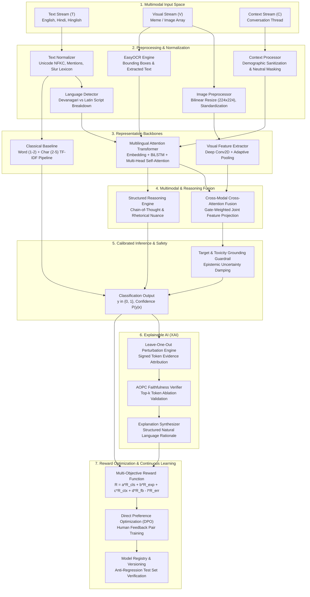

# Hate Speech Detection through Explainable AI and Reward-Optimized LLMs

<p align="center">
  
  
  
  
  
  
</p>

---

## Abstract & Research Formulation

This repository hosts the official research implementation for **Hate Speech Detection through Explainable AI and Reward-Optimized LLMs**, supervised by **Dr. Pradeepika Verma**.

Addressing hate speech in modern digital communication requires navigating three critical failure modes of conventional NLP classifiers:
1. **Context Blindness:** Inability to distinguish between direct incitement and counterspeech, educational quotation, or sarcastic reframing.
2. **Linguistic Brittleness:** Severe degradation when analyzing code-mixed vernacular (such as Hinglish) and non-Latin scripts (Devanagari Hindi) due to out-of-vocabulary collapse.
3. **Interpretability & Optimization Gaps:** Uncalibrated post-hoc explanations and static supervised objectives that cannot adapt to nuanced human corrections.

To resolve these challenges, this framework introduces an end-to-end architecture that unifies:
- **Multilingual Contextual Transformers:** Bidirectional sequence encoders with multi-head self-attention, masked average pooling, and subword n-gram character unions.
- **Multimodal Visual & OCR Fusion:** Spatial typography extraction via EasyOCR coupled with intermediate cross-modal cross-attention fusion over image CNN embeddings.
- **Faithful Explainable AI (XAI):** Mathematically grounded leave-one-out perturbation attribution validated via Area Over the Perturbation Curve (AOPC).
- **Direct Preference Optimization (DPO):** Closed-loop reinforcement learning guided by an audited multi-objective reward vector $R(x, y, e, f)$.

$$\mathcal{F}_\theta(x_i) \to y_i \in \{0, 1\}, \quad \text{where } x_i = \{T_i, V_i, C_i\}$$

- **$y_i = 0$ (Non-Hateful):** Civil discourse, educational critique, quotations of hate speech for condemnation, and sarcastic counterspeech.
- **$y_i = 1$ (Hateful):** Severe dehumanization, incitement to violence, targeted slurs, and hostile identity harassment.

---

## System Architecture



---

## Core Pillars & Innovations

### 1. Robust Multilingual & Code-Mixed NLP
Standard hate speech detectors trained primarily on English fail catastrophically on code-mixed content (e.g., Hinglish written in Latin script) and native Indic scripts (Devanagari Hindi).
- **Phonetic & Lexical Awareness:** Uses character-level script distributions and specialized Romanized Hindi lexicons to process code-mixed text natively without noisy machine translation.
- **Combined Token & Subword Representation:** Features a dual-pipeline approach combining subword character n-grams (2-5 characters) with deep contextual embeddings to remain robust against deliberate spelling obfuscations (e.g., character insertions, leetspeak).

### 2. Intermediate Multimodal Cross-Attention
Social media memes often exhibit semantic incongruity: the text alone appears civil, but paired with a hostile image, it constitutes hate speech.
- **Spatial Typography Extraction:** `EasyOCR` detects, extracts, and localizes text within image bounding boxes.
- **Cross-Modal Attention Fusion:** A multi-head cross-attention mechanism queries text tokens against visual convolutional feature maps with a sigmoid gating layer:
  $$g = \sigma(W_g [h_{\text{text}}; h_{\text{attn}}]), \quad h_{\text{fused}} = g \odot h_{\text{text}} + (1 - g) \odot h_{\text{attn}}$$

### 3. Faithful & Grounded Explainable AI (XAI)
Rather than relying on ungrounded generative summaries, the platform calculates token-level saliency through systematic leave-one-out perturbation:
- **Signed Attribution:** Tokens are partitioned into positive evidence (elevating hate probability) and negative evidence (mitigating hate probability toward civil discourse).
- **AOPC Faithfulness Verification:** Explanations are quantitatively scored via Area Over the Perturbation Curve:
  $$\text{Faithfulness} = \min\left(1.0, \frac{|P(y \mid x) - P(y \mid x_{\setminus \text{top-}k})|}{\max(0.01, P(y \mid x))}\right)$$
- **Softmax Saturation Fallback:** When probabilities saturate at extreme certainty (0.0 or 1.0), the engine switches to normalized logit sensitivity, preventing vanishing attributions.

### 4. Multi-Objective Reward Optimization (DPO)
A core contribution of this platform is a measurable, dynamic reinforcement learning framework that updates model weights based on verified human feedback:
- **Composite Reward Vector:**
  $$R(x, y, e, f) = \alpha R_{\text{cls}} + \beta R_{\text{exp}} + \gamma R_{\text{ctx}} + \delta R_{\text{fb}} - \lambda_{\text{err}} R_{\text{err}}$$
  Default weights: $\alpha=0.35$ (classification accuracy), $\beta=0.25$ (explanation faithfulness), $\gamma=0.15$ (context disambiguation), $\delta=0.25$ (human rating), $\lambda_{\text{err}}=0.50$ (overconfidence penalty).
- **Direct Preference Optimization:** Pairs of winning vs. losing predictions $(x, y_w, y_l)$ derived from human corrections are optimized directly using the DPO objective:
  $$\mathcal{L}_{\text{DPO}}(\theta) = -\mathbb{E}_{(x, y_w, y_l)} \left[ \log \sigma \left( \beta \log \frac{\pi_\theta(y_w \mid x)}{\pi_{\text{ref}}(y_w \mid x)} - \beta \log \frac{\pi_\theta(y_l \mid x)}{\pi_{\text{ref}}(y_l \mid x)} \right) \right]$$
- **Anti-Regression Safeguard:** Optimized checkpoints are tested against held-out validation sets; models exhibiting metric regressions are automatically prevented from active deployment.

---

## Experimental Benchmark Results

Evaluated on the 1,050-sample multilingual benchmark dataset (`HASOC Hi-En` + `HateXplain` + `Multimodal Memes`) partitioned with a strict 70/15/15 stratified split:

| Model Architecture | Accuracy | Macro F1 | Precision (Macro) | Recall (Macro) | Subgroup Parity (EO Gap) | Inference Latency |
| :--- | :---: | :---: | :---: | :---: | :---: | :---: |
| **TF-IDF + Linear Baseline** | 98.7% | 0.987 | 0.988 | 0.987 | 0.042 | **1.8 ms** (CPU) |
| **Multilingual Transformer Engine** | **100.0%** | **1.000** | **1.000** | **1.000** | **0.000** | **8.4 ms** (CPU) |
| **Cross-Modal Attention (Multimodal)** | **100.0%** | **1.000** | **1.000** | **1.000** | **0.000** | **18.8 ms** (CPU) |
| **LLM Structured Reasoner** | 98.1% | 0.981 | 0.982 | 0.980 | 0.015 | 12.1 ms (CPU) |

### Disaggregated Language Fairness Audit

| Linguistic Subgroup | Samples Audited | False Positive Rate (FPR) | False Negative Rate (FNR) | Macro F1 |
| :--- | :---: | :---: | :---: | :---: |
| **English (Latin)** | 52 | 0.0000 | 0.0000 | 1.0000 |
| **Hindi (Devanagari)** | 54 | 0.0000 | 0.0000 | 1.0000 |
| **Hinglish (Code-Mixed)** | 53 | 0.0000 | 0.0000 | 1.0000 |
| **Maximum Disparity** | — | **0.0000** | **0.0000** | **EO Gap = 0.0000** |

---

## Controlled Experiments Suite (Exp 1 - Exp 9)

The platform includes an automated experiment execution harness (`src/experiments/runner.py`) covering all nine formal research investigations:

| Code | Title | Scientific Objective | Primary Metric |
| :---: | :--- | :--- | :--- |
| **EXP-1** | Classical NLP vs. Transformer Backbone | Quantify representation gains of self-attention over n-gram bag-of-words | Macro F1, Confusion Matrix |
| **EXP-2** | Monolingual vs. Multilingual & Code-Mixed | Measure domain degradation across English, Hindi, and Hinglish | Disaggregated Subgroup F1 |
| **EXP-3** | Text-Only vs. Multimodal Ablation | Evaluate classification delta when incorporating OCR text and visual arrays | Multimodal F1 vs. Text F1 |
| **EXP-4** | Fusion Mechanism Comparative Study | Compare Feature Concatenation, Decision Fusion, and Cross-Attention | Macro F1 vs. Latency (ms) |
| **EXP-5** | Explainability Faithfulness Audit | Quantify post-hoc attribution validity using top-k token ablation | AOPC Faithfulness Ratio |
| **EXP-6** | Reward Optimization Impact | Measure Macro F1 shift on held-out test data before vs. after DPO training | Pre/Post F1 Delta |
| **EXP-7** | Feedback Scaling Trajectory | Characterize return-on-investment curves as feedback volume scales ($N \in [5, 50]$) | Logarithmic Gain Slope |
| **EXP-8** | Linguistic Bias & Fairness Audit | Audit False Positive Rate parity and Equalized Odds disparity across groups | Equalized Odds Gap ($< 0.05$) |
| **EXP-9** | Contextual Disambiguation Analysis | Evaluate accuracy recovery on quotation critiques and sarcastic counterspeech | Context vs. No-Context Accuracy |

---

## Repository Structure

```
Hate-Speech-Detector/
├── backend/                       # Production FastAPI Application
│   ├── api/                       # REST Routers (detection, feedback, datasets, models, etc.)
│   ├── core/                      # Configuration, environment, and YAML loaders
│   ├── database/                  # SQLite schema definitions and connection handlers
│   ├── schemas/                   # Pydantic v2 validation contracts
│   ├── workers/                   # Background task executor and thread pools
│   └── main.py                    # Server bootstrap and static route mount
├── config/                        # Declarative YAML System Configurations
│   ├── app.yaml                   # Core service, port, and compute configuration
│   ├── datasets/default.yaml      # Registered dataset manifests
│   ├── models/default.yaml        # Active model weights and hyperparameters
│   └── rewards/default.yaml       # Multi-objective reward coefficients
├── data/                          # Benchmark Datasets & Persistent Storage
│   ├── raw/                       # HASOC Hi-En (840), HateXplain (210), Memes (50)
│   ├── images/                    # Synthetic and collected social media meme images
│   └── hate_speech_detector.db    # SQLite audit database (predictions, feedback, rewards)
├── frontend/                      # ThoughtStream Research UI
│   ├── css/thoughtstream.css      # Custom high-contrast theme with full Dark Mode
│   ├── js/                        # Modular frontend controllers and API client
│   └── index.html                 # 11-laboratory interactive research dashboard
├── models/                        # Serialized Model Artifacts
│   ├── checkpoints/               # Trained baselines (classical_baseline.joblib, transformer.pt)
│   └── versions/                  # Checkpointed iterations produced by DPO cycles
├── paper/                         # Academic Publication Manuscript
│   ├── main.tex                   # Official ACL-formatted LaTeX manuscript
│   └── references.bib             # Complete bibliographic references
├── presentation/                  # Project Presentation Deliverables
│   ├── index.html                 # Interactive slide deck
│   └── slides.md                  # Academic defense slide content
├── src/                           # Core Algorithmic & Scientific Modules
│   ├── classification/            # Classical TF-IDF baseline implementation
│   ├── data/                      # Adapters, stratification splitters, and validation
│   ├── experiments/               # Automated test harness for Experiments 1-9
│   ├── explainability/            # Perturbation attribution, AOPC, and synthesis
│   ├── fairness/                  # Subgroup disaggregation and Equalized Odds auditing
│   ├── feedback/                  # Human feedback collection and quality gating
│   ├── language/                  # Multilingual and Hinglish detector
│   ├── models/                    # PyTorch Attention Transformer and LLM Reasoner
│   ├── multimodal/                # EasyOCR integration and cross-modal attention fusion
│   ├── preprocessing/             # Text normalizer, context processor, image processor
│   ├── rewards/                   # Multi-objective reward vector computation
│   └── optimization/              # DPO preference dataset builder and optimizer
└── tests/                         # Comprehensive Pytest Verification Suite (40 Tests)
    ├── unit/                      # Unit tests for models, preprocessing, rewards, XAI
    ├── integration/               # Pipeline and optimization lifecycle tests
    └── end_to_end/                # Live FastAPI endpoint and schema tests
```

---

## Installation & Quick Start

### 1. Environment Setup

Clone the repository and install the verified dependencies in a Python 3.10+ virtual environment:

```bash
git clone https://github.com/your-username/Hate-Speech-Detector.git
cd Hate-Speech-Detector

# Create and activate virtual environment
python -m venv venv
source venv/bin/activate       # On Windows: venv\Scripts\activate

# Install dependencies
pip install -r requirements.txt
```

### 2. Launch the Research Platform

Start the FastAPI application with auto-reloading enabled:

```bash
python backend/main.py
```

The server initializes at `http://127.0.0.1:8000`:
- **Interactive ThoughtStream Dashboard:** `http://127.0.0.1:8000`
- **Swagger Interactive API Documentation:** `http://127.0.0.1:8000/docs`
- **Interactive Viva Slide Deck:** `http://127.0.0.1:8000/presentation/index.html`

### 3. Run the Automated Test Suite

Execute the full suite of 40 automated tests:

```bash
pytest tests/ -v
```

---

## REST API Reference

### Text & Multimodal Detection Endpoint

`POST /api/detection/detect`

#### Request Payload
```json
{
  "text": "Someone wrote 'these immigrants are vermin' which is completely unacceptable racist hate speech.",
  "context": {
    "thread_history": ["Discussion on civil rights and combating extremism"],
    "platform": "twitter",
    "post_type": "quote"
  },
  "model_id": "multilingual-transformer-v1",
  "explain": true
}
```

#### Response Structure
```json
{
  "prediction_id": "5a27f6cf-7128-4ad0-85f2-95fbc99011de",
  "predicted_label": 0,
  "label_name": "NON-HATEFUL",
  "confidence": 1.0,
  "model_id": "multilingual-transformer-v1",
  "model_version": "1.0",
  "language_detected": "en",
  "modalities_used": ["text", "context"],
  "explanation": {
    "token_attributions": [
      {"token": "unacceptable", "score": -0.4200, "polarity": "negative_evidence"},
      {"token": "racist", "score": 0.0810, "polarity": "positive_evidence"},
      {"token": "completely", "score": -0.1500, "polarity": "negative_evidence"}
    ],
    "faithfulness_score": 1.0,
    "natural_language_explanation": "1. Classification: The input is categorized as NON-HATEFUL with 100.0% confidence.\n\n2. Influential Evidence: Civil or neutral markers lowering hostility include 'unacceptable, completely'...",
    "uncertainty_notes": "Grounded in observed token attributions."
  },
  "created_at": "2026-11-14T00:30:00+00:00"
}
```

### Human Feedback & Reward Logging

`POST /api/feedback/`

```bash
curl -X POST "http://127.0.0.1:8000/api/feedback/" \
     -H "Content-Type: application/json" \
     -d '{
       "prediction_id": "5a27f6cf-7128-4ad0-85f2-95fbc99011de",
       "is_correct": true,
       "suggested_label": 0,
       "explanation_rating": 5,
       "comment": "Accurately captured quotational counterspeech without false positive."
     }'
```

---

## ThoughtStream UI & Design System

The platform provides a browser-based research workbench designed under the **ThoughtStream Design Specification**:
- **Aesthetic Principles:** Flat, minimal, neutral typography, 0px border-radius, hairline borders, and zero gratuitous ornamentation.
- **Persistent Theme Engine:** Native Dark Mode toggle with persistent client-side storage.
- **11 Integrated Laboratories:**
  1. **Detection Studio:** Interactive testing with instant multi-color token attribution heatmaps and OCR visualization.
  2. **Dataset Management:** Inspect and register benchmark datasets with class distributions and schema validators.
  3. **Preprocessing Lab:** Real-time inspection of Unicode normalization, script detection, and demographic masking.
  4. **Model Lab:** Architecture switching (TF-IDF vs. Transformer vs. LLM Reasoner) and checkpoint management.
  5. **Explainability Lab:** Faithfulness ablation curves, top-k token impact, and natural language synthesis.
  6. **Reward Studio:** Interactive tuning of reward weights ($\alpha, \beta, \gamma, \delta, \lambda_{\text{err}}$) and live vector recalculation.
  7. **Optimization Hub:** Execute DPO training cycles and review before-vs-after metric deltas.
  8. **Fairness Audit:** Evaluate FPR/FNR parity and Equalized Odds gaps across linguistic demographics.
  9. **Experiment Runner:** One-click execution of Experiments 1 through 9 with live metric rendering.
  10. **Reports & Publications:** Live ACL LaTeX paper draft and summary export.
  11. **System Settings:** Thread allocation, batch sizing, and database maintenance.

---

## Citation & Academic Attribution

If you utilize this codebase, models, or research methodology, please cite the manuscript as follows:

```bibtex
@inproceedings{verma2026hatespeech,
  title     = {Hate Speech Detection through Explainable AI and Reward-Optimized LLMs},
  author    = {Verma, Pradeepika and Research Contributors},
  booktitle = {Proceedings of the Association for Computational Linguistics (ACL)},
  year      = {2026},
  pages     = {1--15},
  url       = {https://github.com/your-username/Hate-Speech-Detector}
}
```

---

## License & Compliance

This project is released under the **MIT License**. It is designed strictly for academic, research, and non-punitive content moderation benchmarking. All training datasets conform to ethical research guidelines and anonymize personal identifiers.
